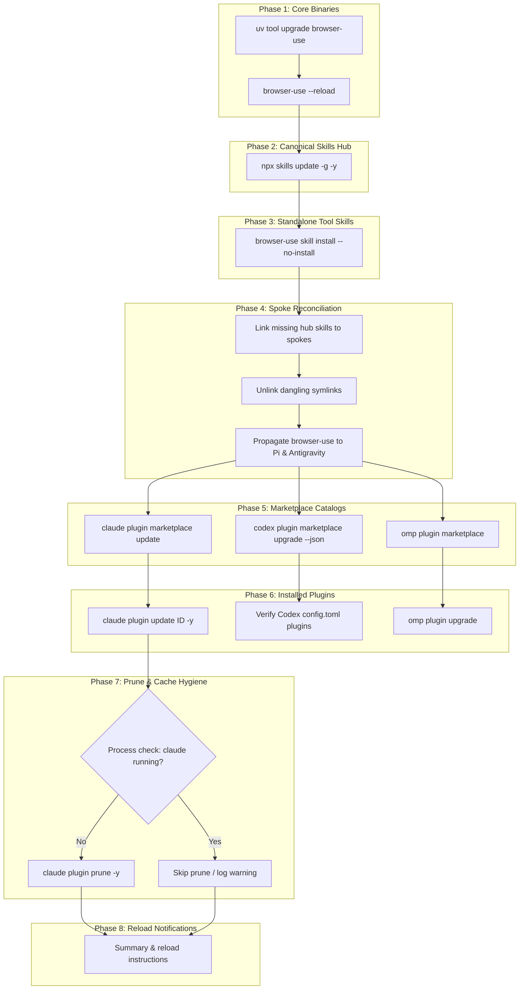

# Unified Agent Updater: Architecture, Sequence & Implementation Plan

A design and implementation plan to expand `update-plugins` from a Claude-only utility into a unified agent updater covering **Claude Code**, **Oh-My-Pi (OMP)**, **Codex**, **Pi**, and **Gemini / Antigravity**.

---

## 1. System Topology & Architecture

### Current State

Agents on this workstation share a **hybrid hub-and-spoke model**:

```
                       ┌─────────────────────────────────────┐
                       │ Canonical Skills Hub                │
                       │ ~/.agents/skills/                   │
                       │ • 19 npx skills (Vue, DuckDB, Fallow)│
                       │ • 1 standalone skill (browser-use)  │
                       └──────────────────┬──────────────────┘
                                          │
       ┌──────────────────────┬───────────┴──────────┬──────────────────────┐
       │                      │                      │                      │
(per-skill symlinks)   (per-skill symlinks)   (directory symlink)    (per-skill symlinks)
       │                      │                      │                      │
       ▼                      ▼                      ▼                      ▼
~/.claude/skills/      ~/.pi/agent/skills/    ~/.omp/agent/skills/   ~/.gemini/config/skills/
  19 symlinks            19 symlinks            1 dir symlink          19 symlinks
  + browser-use/         (no browser-use)       (sees all 20)          (no browser-use here)
  (physical directory)                                               ~/.gemini/skills/
                                                                      (browser-use copy)
```

### Registries & Managers

| Subsystem                | Managed Locations                                                                                                                       | Mechanism & State Files                                                                          |
| :----------------------- | :-------------------------------------------------------------------------------------------------------------------------------------- | :----------------------------------------------------------------------------------------------- |
| **Global Skills**        | `~/.agents/skills/`                                                                                                                     | `npx skills` via `~/.agents/.skill-lock.json`                                                    |
| **Tool Skills**          | `~/.agents/skills/browser-use/`<br>`~/.claude/skills/browser-use/`<br>`~/.codex/skills/browser-use/`<br>`~/.gemini/skills/browser-use/` | `browser-use skill install --no-install` (copies physical directories)                           |
| **Claude Plugins**       | `~/.claude/plugins/`                                                                                                                    | `claude plugin` CLI via `~/.claude/plugins/installed_plugins.json`                               |
| **Codex Marketplaces**   | `~/.codex/.tmp/marketplaces/`<br>`~/.cache/codex-runtimes/`                                                                             | `/Applications/Codex.app/Contents/Resources/codex plugin marketplace` via `~/.codex/config.toml` |
| **OMP Plugins**          | `~/.omp/plugins/`<br>`~/.omp/agent/`                                                                                                    | `omp plugin` CLI; inherits Claude plugins via `enabledProviders: [claude-plugins]`               |
| **Antigravity / Gemini** | `~/.gemini/config/skills/`<br>`~/.gemini/config/plugins/`                                                                               | Static symlinks to `~/.agents/skills/`; local plugins in `config/plugins/`                       |

---

## 2. Execution Sequence

The update pipeline follows eight strict phases. Ordering is dictated by dependency flow: tool binaries produce skill definitions; canonical skills feed spokes; marketplace catalogs index plugins before plugins can be fetched; pruning must only happen after new versions land.

```
Phase 1: Tool Binaries (uv / tool upgrades)
   ↳ Phase 2: Canonical Skills Hub (~/.agents/skills)
      ↳ Phase 3: Standalone Tool Skill Generation (browser-use)
         ↳ Phase 4: Hub-and-Spoke Reconciliation (heal & prune links)
            ↳ Phase 5: Remote Marketplaces (Claude, Codex, OMP)
               ↳ Phase 6: Agent-Specific Plugins (Claude, Codex, OMP)
                  ↳ Phase 7: Cache Pruning (guarded by process checks)
                     ↳ Phase 8: Active Process Check & Reload Signals
```



### Step-by-Step Breakdown

#### Phase 1: Tool Binaries

- **Command**: `uv tool upgrade browser-use` (fallback: `browser-use --update -y`).
- **Daemon Reload**: `browser-use --reload`.
- **Constraint**: Must precede skill installation. `browser-use skill install` generates `SKILL.md` using the installed binary's CLI introspection.

#### Phase 2: Canonical Skills Hub

- **Command**: `npx skills update -g -y`.
- **Constraint**: Must precede spoke reconciliation. Operates on `~/.agents/skills/` and updates `~/.agents/.skill-lock.json`. Updates Vue skills, DuckDB skills, and Fallow skills at the root.

#### Phase 3: Standalone Tool Skills

- **Command**: `browser-use skill install --no-install`.
- **Constraint**: Must run after `npx skills update` so `npx skills` does not treat `browser-use` as a stale or unmanaged package in the canonical hub.

#### Phase 4: Hub-and-Spoke Reconciliation

- **Tasks**:
  1. Scan `~/.agents/skills/`. For each skill directory, verify that a valid symlink exists in:
     - `~/.claude/skills/`
     - `~/.pi/agent/skills/`
     - `~/.gemini/config/skills/`
       _(Note: `~/.omp/agent/skills` is a directory-level symlink and requires no per-skill intervention)._
  2. Heal omissions: link `browser-use` into `~/.pi/agent/skills/` and `~/.gemini/config/skills/` (which `browser-use skill install` currently misses).
  3. Prune broken links: delete dangling symlinks pointing to nonexistent canonical targets.

#### Phase 5: Remote Marketplaces

- **Claude**: `claude plugin marketplace update </dev/null`.
- **Codex**: `/Applications/Codex.app/Contents/Resources/codex plugin marketplace upgrade --json`.
- **OMP**: `omp plugin marketplace`.
- **Constraint**: Must precede plugin updates. Local catalog caches index available versions and git commit SHAs.

#### Phase 6: Installed Plugins

- **Claude**: Iterate installed plugin IDs in `~/.claude/plugins/installed_plugins.json`, run `claude plugin update <id> -y`, compare before/after fingerprint.
- **Codex**: Validate enabled plugins against updated marketplace repositories (e.g. `ponytail`).
- **OMP**: Run `omp plugin upgrade`. Because OMP enables `claude-plugins` (`enabledProviders: [claude-plugins]`), Claude updates automatically update OMP's Claude-backed plugins.

#### Phase 7: Prune & Cache Hygiene

- **Safety Preflight**: Check if `claude` is running (`pgrep -x claude`).
- **Action**: If idle, run `claude plugin prune -y`. If active, skip prune and log a warning to prevent deleting cached directories actively open in memory.

#### Phase 8: Active Process Check & Reload Signals

- **Detection**: Check `pgrep -x "claude|codex|omp"`.
- **Output**: Print clear reload hints for any active processes:
  - OMP: run `/reload-plugins` in active terminal.
  - Claude / Codex: restart application window.

---

## 3. Risks & Failure Modes to Avoid

### 1. Dangling Symlinks from Upstream Skill Removals

- **Problem**: When a skill is removed upstream, `npx skills update` deletes `~/.agents/skills/<name>`.
- **Breakage**: `~/.claude/skills/<name>` and `~/.pi/agent/skills/<name>` become dead symlinks. Claude Code and Pi crash or emit startup warnings (`ENOENT`).
- **Mitigation**: Phase 4 automatically sweeps all agent skill directories for dead symlinks:
  ```go
  if target, err := os.Readlink(linkPath); err == nil {
      resolved := filepath.Join(filepath.Dir(linkPath), target)
      if _, err := os.Stat(resolved); os.IsNotExist(err) {
          os.Remove(linkPath)
      }
  }
  ```

### 2. Copy vs. Symlink Collision (`browser-use`)

- **Problem**: `browser-use skill install` creates a physical directory copy at `~/.claude/skills/browser-use/` (10.5 KB `SKILL.md`), while all 19 other skills are symlinks.
- **Breakage**: Symlink managers will either refuse to overwrite a physical folder or overwrite it, causing `browser-use` updates to drift across targets.
- **Mitigation**: Allow `browser-use` to update canonical `~/.agents/skills/browser-use/` and Claude's copy, then explicitly ensure spokes that lack it (`~/.pi/agent/skills/` and `~/.gemini/config/skills/`) receive symlinks pointing to `~/.agents/skills/browser-use/`.

### 3. Hanging Non-Interactive Sessions

- **Problem**: `claude plugin marketplace update`, `codex plugin marketplace upgrade`, and `npx skills` can prompt for Git credentials or confirmation if stdin is open or TTY is detected.
- **Breakage**: CI or background terminal jobs freeze indefinitely.
- **Mitigation**:
  - Pass empty stdin (`strings.NewReader("")`) to all background commands.
  - Inject environment variables:
    ```go
    cmd.Env = append(os.Environ(),
        "GIT_TERMINAL_PROMPT=0",
        "CI=1",
        "DEBIAN_FRONTEND=noninteractive",
    )
    ```
  - Enforce a 60–90 second timeout on every external command.

### 4. Binary Discovery Failure

- **Problem**: `codex` is at `/Applications/Codex.app/Contents/Resources/codex` and is often omitted from `$PATH`. `omp` is in `~/.bun/bin/omp`.
- **Breakage**: `exec.LookPath("codex")` fails, silently skipping Codex marketplace updates.
- **Mitigation**: Implement a fallback path resolver:
  ```go
  func findExecutable(name string, fallbacks []string) string {
      if p, err := exec.LookPath(name); err == nil {
          return p
      }
      for _, fb := range fallbacks {
          if _, err := os.Stat(fb); err == nil {
              return fb
          }
      }
      return ""
  }
  ```
  Registered fallbacks:
  - `codex`: `/Applications/Codex.app/Contents/Resources/codex`, `~/.local/bin/codex`
  - `omp`: `~/.bun/bin/omp`, `~/.local/bin/omp`
  - `claude`: `~/.local/bin/claude`, `~/.npm-global/bin/claude`

### 5. Mid-Session Cache Deletion Race

- **Problem**: Claude plugins execute out of version-stamped cache directories (`~/.claude/plugins/cache/<pkg>/<version>/`).
- **Breakage**: Updating downloads a new version. Running `claude plugin prune` deletes the old version directory while an active Claude process holds file descriptors or imports from it.
- **Mitigation**: Check `pgrep claude` before running prune. If active, skip prune: `"▲ Active Claude Code session detected; skipping prune to avoid invalidating loaded plugins."`

### 6. Cross-Marketplace Revision Desync (`ponytail`)

- **Problem**: `ponytail` is tracked both in Claude (`installed_plugins.json`) and in Codex (`~/.codex/config.toml` Git marketplace).
- **Breakage**: Updating Claude does not update Codex's clone (`~/.codex/.tmp/marketplaces/ponytail`).
- **Mitigation**: Keep marketplace refresh explicit per agent in Phase 5. Both `claude plugin marketplace update` and `codex plugin marketplace upgrade` are executed.

---

## 4. Implementation Structure

The Go codebase in `functions/update-plugins/` will be organized into distinct modules:

```
functions/update-plugins/
├── go.mod
├── go.sum
├── main.go               # CLI parser, orchestration loop, banner & summary table
├── paths.go              # Executable fallback resolution & agent directory constants
├── phase_binaries.go     # Phase 1: Tool binary upgrades (uv tool upgrade browser-use)
├── phase_skills.go       # Phase 2 & 3: npx skills update & browser-use skill install
├── phase_reconcile.go    # Phase 4: Hub-and-spoke symlink health, healing & pruning
├── phase_marketplaces.go # Phase 5: Catalog refreshes for Claude, Codex, OMP
├── phase_plugins.go      # Phase 6: Plugin iteration & fingerprint diffing
├── phase_prune.go        # Phase 7: Claude prune with active-process preflight
└── main_test.go          # Unit tests: symlink healing, dangling link prune, fingerprint diffing
```

### CLI Flag Specification

```
USAGE
  update-plugins [flags]

FLAGS
  -y, --yes          Auto-accept confirmation prompts
  -d, --dry-run      Simulate execution without running mutation commands
  --skills-only      Run only skill phases (Phases 1-4)
  --plugins-only     Run only plugin & marketplace phases (Phases 5-7)
  --skip-prune       Skip cache pruning step
  --agents <list>    Comma-separated list of target agents (claude,codex,omp,gemini,pi)
  -h, --help         Show help message
```

---

## 5. Verification & Testing Checklist

- [ ] **Unit Tests**:
  - `TestReconcileSymlinks`: Mock canonical hub with 3 skills; ensure spokes missing any skill receive correct relative/absolute symlinks.
  - `TestPruneDanglingSymlinks`: Create dead symlink in mock spoke; verify reconciliation deletes the dead link.
  - `TestPluginFingerprint`: Verify fingerprint calculation matches format `scope|version|gitCommitSha|installPath`.
- [ ] **Smoke Tests**:
  - `update-plugins --dry-run`: Verify full visual pipeline output without making filesystem changes.
  - `update-plugins --skills-only`: Verify `npx skills update` runs, `browser-use` is updated, and spoke symlinks remain intact.
  - `update-plugins --plugins-only`: Verify marketplace catalogs and installed plugins update without touching skill directories.
  - `update-plugins`: Verify end-to-end execution, summary table rendering, and process detection.
